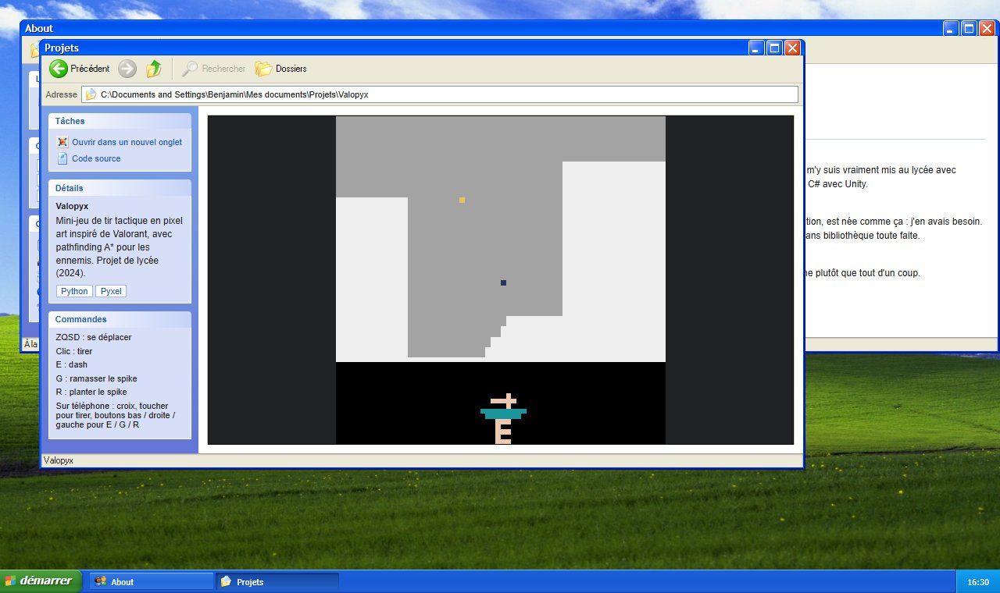

# Portfolio XP

Mon portfolio de développeur, sous la forme d'un bureau Windows XP : on ouvre une session, on lance des applications dans des fenêtres qu'on déplace, réduit et agrandit, et chaque application présente une partie de mon parcours.



## Fonctionnalités

- **Écran de connexion** façon Windows XP
- **Fenêtres** déplaçables par la barre de titre, gardées dans les limites de l'écran, qui passent au premier plan au clic
- **Réduire, agrandir, restaurer, fermer**, avec ouverture en cascade
- **Barre des tâches** avec un bouton par fenêtre ouverte et l'horloge
- **Menu Démarrer** : applications, liens, fermeture de session
- **4 applications** :
  - **About** : présentation, compétences et outils
  - **Projets** : mes projets, présentés comme dans l'Explorateur Windows, avec une démo pour chacun quand c'est possible :
    - **jeu Pyxel jouable** dans la fenêtre (Python compilé pour le navigateur avec Pyodide), avec une manette virtuelle sur téléphone
    - **partie de terminal rejouée** pour les projets en ligne de commande, à partir d'une vraie partie enregistrée
    - **avancement** (fait, à faire) et schéma d'architecture pour les projets en cours
  - **CV** : aperçu avec zoom et téléchargement en PDF
  - **Contact** : formulaire envoyé avec Formspree, lien vers LinkedIn
- **Mobile** : ouverture au toucher, fenêtres agrandies, déplacement au doigt, démos jouables en plein onglet
- **Administration** : page `/admin/` pour modifier les projets, la présentation, le CV et le contact sans toucher au code

## Technologies

- **Vue 3** (Composition API, `<script setup>`) et **Vite**
- **Pinia** pour l'état des fenêtres, de la session et du contenu
- **Supabase** (Postgres, authentification, stockage de fichiers) pour le contenu modifiable depuis l'admin
- **[XP.css](https://botoxparty.github.io/XP.css/)** pour le style des fenêtres. La barre des tâches, le menu Démarrer et l'écran de connexion sont écrits à la main.

## Choix techniques

- **Gestionnaire de fenêtres fait main**, sans bibliothèque : ordre d'affichage par `z-index` avec un compteur, focus au `mousedown` comme sous XP, déplacement avec des écouteurs `mousemove` / `mouseup` sur `document`, position bornée à la zone visible.
- **Contenu séparé du code** : le site lit les projets et les textes dans Supabase (store `content`). `src/data/` contient les mêmes données et sert de secours si Supabase ne répond pas.
- **Une seule source pour les applications** : `src/data/apps.js` décrit chaque application (nom, icône, composant). Le bureau, la barre des tâches et le menu Démarrer s'en servent tous.
- **Démos chargées à la demande** : rien n'est téléchargé avant le clic sur « Lancer la démo ». Une fenêtre inactive rend ses iframes transparentes à la souris, pour que le premier clic dans un jeu donne le focus à la fenêtre, comme sous XP.

## Lancer le projet

Prérequis : Node.js 22.18 ou plus récent.

```bash
git clone https://github.com/Benjamingllm/Portfolio.git
cd Portfolio
npm install
npm run dev
```

Sans configuration, le site utilise les données de `src/data/`. Pour lire Supabase, copier `.env.example` en `.env.local` et renseigner `VITE_SUPABASE_URL` et `VITE_SUPABASE_ANON_KEY`. Le schéma de la base est dans `docs/supabase.sql`, puis `docs/supabase-demos.sql`.

Pour la version de production :

```bash
npm run build
npm run preview
```

## Organisation du code

```
src/
├── App.vue                écran de connexion ou bureau, chargement du contenu
├── components/
│   ├── AppWindow.vue      une fenêtre : déplacement, réduire, agrandir, fermer
│   ├── LoginScreen.vue    écran de connexion
│   ├── Desktop.vue        bureau et icônes
│   ├── taskbar.vue        barre des tâches
│   ├── StartMenu.vue      menu Démarrer
│   ├── TaskbarClock.vue   horloge de la barre des tâches
│   ├── ProjectDemo.vue    aperçu et lancement de la démo d'un projet
│   ├── TerminalReplay.vue partie de terminal rejouée
│   └── apps/              About, Projets, CV, Contact
├── data/                  contenu : applications, présentation, projets, partie du RPG
├── utils/touch.js         détection des écrans tactiles
├── lib/supabase.js        client Supabase et envoi de fichiers
├── admin/                 page d'administration (/admin/)
└── stores/
    ├── windows.js         fenêtres ouvertes, ordre, position, état
    ├── session.js         session ouverte ou fermée
    └── content.js         contenu lu dans Supabase, src/data/ en secours
```

Les démos jouables sont dans `public/demos/`.

---

Projet personnel réalisé par Benjamin Guillaume, étudiant en 2e année de Bachelor à Sup de Vinci. Sans lien avec Microsoft.
