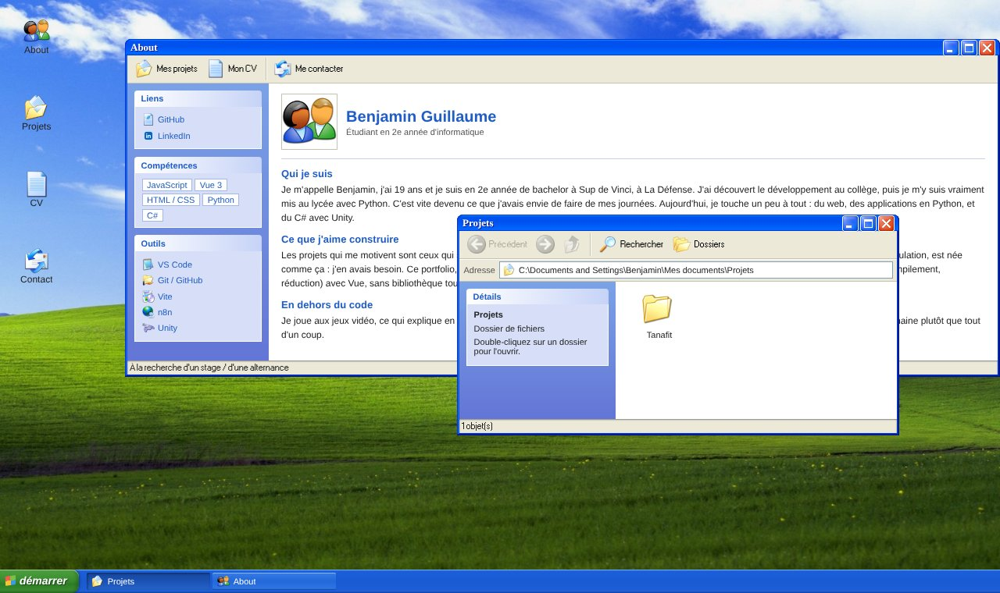

# Portfolio XP

Mon portfolio de développeur, sous la forme d'un bureau Windows XP : on ouvre une session, on lance des applications dans des fenêtres qu'on déplace, réduit et agrandit, et chaque application présente une partie de mon parcours.



## Fonctionnalités

- **Écran de connexion** façon Windows XP
- **Fenêtres** déplaçables par la barre de titre, gardées dans les limites de l'écran, qui passent au premier plan au clic
- **Réduire, agrandir, restaurer, fermer**, avec ouverture en cascade
- **Barre des tâches** avec un bouton par fenêtre ouverte
- **Menu Démarrer** : applications, liens, fermeture de session
- **4 applications** :
  - **About** : présentation, compétences et outils
  - **Projets** : mes projets, présentés comme dans l'Explorateur Windows
  - **CV** : aperçu avec zoom et téléchargement en PDF
  - **Contact** : formulaire envoyé avec Formspree, lien vers LinkedIn

## Technologies

- **Vue 3** (Composition API, `<script setup>`) et **Vite**
- **Pinia** pour l'état des fenêtres et de la session
- **[XP.css](https://botoxparty.github.io/XP.css/)** pour le style des fenêtres. La barre des tâches, le menu Démarrer et l'écran de connexion sont écrits à la main.

## Choix techniques

- **Gestionnaire de fenêtres fait main**, sans bibliothèque : ordre d'affichage par `z-index` avec un compteur, focus au `mousedown` comme sous XP, déplacement avec des écouteurs `mousemove` / `mouseup` sur `document`, position bornée à la zone visible.
- **Contenu séparé du code** : les textes, les projets et les liens sont dans `src/data/`. On les modifie sans toucher aux composants.
- **Une seule source pour les applications** : `src/data/apps.js` décrit chaque application (nom, icône, composant). Le bureau, la barre des tâches et le menu Démarrer s'en servent tous.

## Lancer le projet

Prérequis : Node.js 22.18 ou plus récent.

```bash
git clone https://github.com/Benjamingllm/Portfolio.git
cd Portfolio
npm install
npm run dev
```

Pour la version de production :

```bash
npm run build
npm run preview
```

## Organisation du code

```
src/
├── App.vue                fenêtres et déplacement, écran de connexion ou bureau
├── components/
│   ├── LoginScreen.vue    écran de connexion
│   ├── Desktop.vue        bureau et icônes
│   ├── taskbar.vue        barre des tâches
│   ├── StartMenu.vue      menu Démarrer
│   └── apps/              About, Projets, CV, Contact
├── data/                  contenu : applications, présentation, projets
└── stores/
    ├── windows.js         fenêtres ouvertes, ordre, position, état
    └── session.js         session ouverte ou fermée
```

## À venir

- Mise en ligne
- Affichage adapté au mobile
- Plus de projets dans l'application Projets
- Horloge dans la barre des tâches

---

Projet personnel réalisé par Benjamin Guillaume, étudiant en 2e année de Bachelor à Sup de Vinci. Sans lien avec Microsoft.
